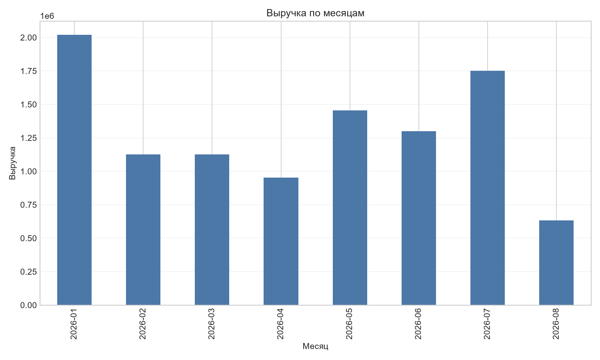
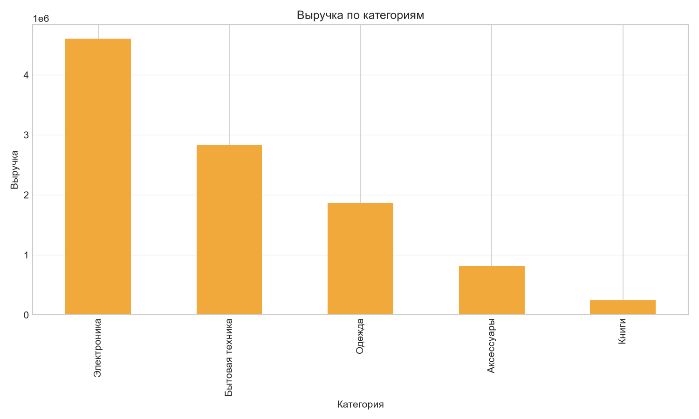
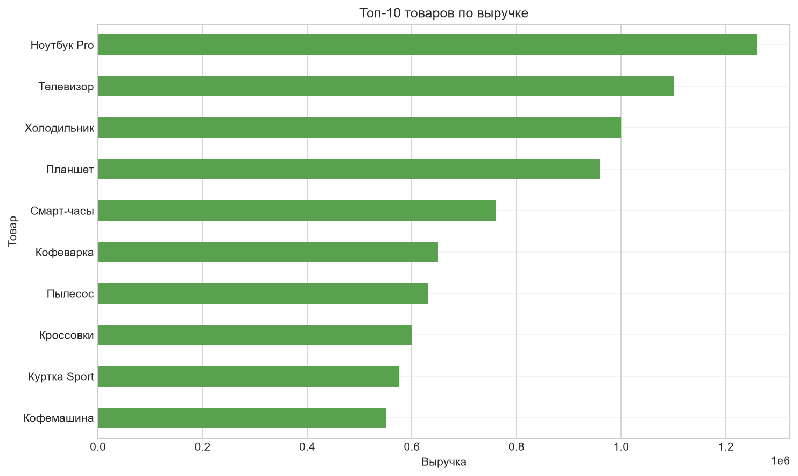

# Анализ продаж

Практическая работа по анализу продаж из базы данных SQLite.

## Данные

База данных: `sales.db`.
Таблица: `sales`.

Колонки таблицы:

- `sale_id` — идентификатор продажи;
- `sale_date` — дата продажи в формате `YYYY-MM-DD`;
- `product` — название товара;
- `category` — категория товара;
- `quantity` — количество единиц;
- `unit_price` — цена одной единицы.

Выручка рассчитывается как `quantity * unit_price`.

## Запуск

Установите зависимости:

```powershell
pip install -r requirements.txt
```

При необходимости восстановите пример базы данных:

```powershell
python create_database.py
```

Запустите анализ:

```powershell
python analysis.py
```

Программа получает данные непосредственно из SQLite, пересчитывает показатели и перезаписывает все PNG-файлы в папке `charts`. После изменения записей в базе повторный запуск `analysis.py` обновит результаты и графики.

## Результаты

Для текущего набора данных в базе `sales.db` получены следующие показатели:

- строк в таблице продаж: 16;
- общая выручка: 10 362 000 (тг);
- продано единиц: 191;
- средняя выручка с одной записи продажи: 647 625 (тг);
- самый успешный месяц: январь 2026 года;
- лидирующая категория: электроника.

После запуска скрипта в папке `charts` создаются три графика:






